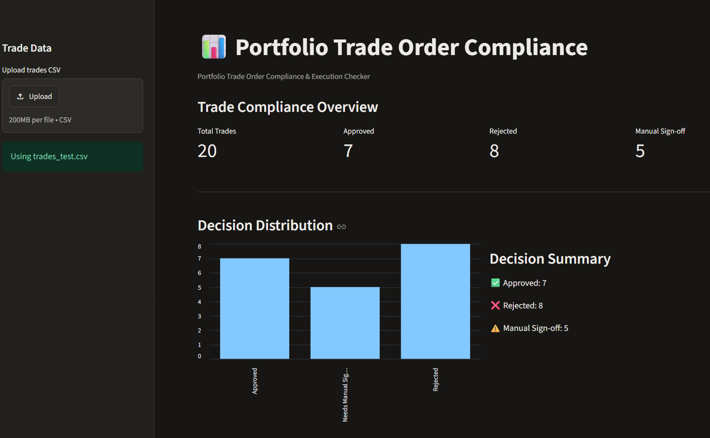
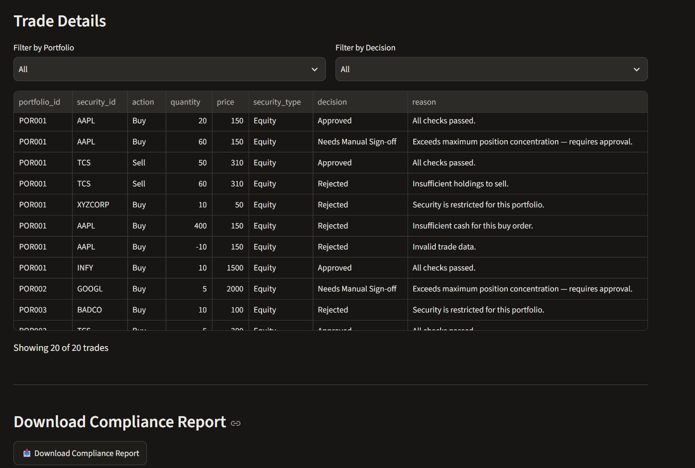

# Portfolio Trade Order Compliance & Execution Checker

## Overview
A Python-based application that validates proposed portfolio trades against predefined compliance and execution rules before execution.

The application evaluates each trade and assigns one of three decisions:
- **Approved** – All compliance checks passed.
- **Rejected** – One or more mandatory validation rules failed.
- **Needs Manual Sign-off** – Position concentration exceeds the permitted limit.

## Key Features
- Trade data validation
- Restricted security checks
- Sell order holdings verification
- Buy order cash affordability checks
- Portfolio position concentration analysis
- Decision and reason generation for each trade

## Technologies Used
- Python 3.14
- CSV file handling
- Dictionaries, Lists and Tuples
- Decimal arithmetic

## Project Structure
```text
Portfolio-Trade-Order-Compliance-Checker/
│
├── main.py
├── trades_test.csv
├── trade_compliance_requirements.md
├── README.md
└── LICENSE
```

## Sample Output

### Output 1 – Trade Validation Results


### Output 2 – Position Concentration and Compliance Results


## Output
Each proposed trade is evaluated and produces:
- Portfolio ID
- Security ID
- Trade action and quantity
- Compliance decision
- Reason for the decision

## Author
Tanisha Verma
